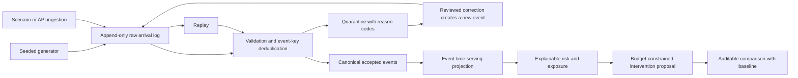

# Relay Operations

A runnable operations decision demo: unreliable logistics events enter a replayable data pipeline, become explainable delivery risk, and feed an intervention plan constrained by a real budget.

The project asks a practical question: **which orders deserve the limited rescue budget, and can an operator trace every input behind that decision?**

All orders, retailers, lanes, events, delays, costs, and outcomes are independently generated from seed `41`. No customer records, employer data, credentials, or external services are used. The simulation clock is **October 14, 2026, 12:00 UTC** so a demo remains reproducible.

## Run

From the repository root, use Python 3.10 or newer:

```sh
python3 server.py
```

Open [Relay Operations](http://127.0.0.1:8000/pipeline-rescue/). The shared server binds to loopback. There are no dependencies to install.

Run the pipeline behavior tests from the repository root:

```sh
python3 -m unittest discover -s tests -p 'test_pipeline.py' -v
```

## Demo in five minutes

1. Start in **Control room**. Inspect the reconciliation equation: each raw arrival is either accepted once, marked duplicate, or quarantined. Open any order to see its event-time history and raw arrival trail.
2. Select **Scanner fault**, then **Inject scenario**. Two invalid events enter quarantine; an identical repeated event stays in raw without increasing the accepted-event count.
3. Open **Event workbench**, inspect a `BAD_DELAY` row, review the correction patch, then append the corrected event. The original payload remains unchanged and its quarantine record becomes resolved.
4. Select **Late arrival** and inject it. The accepted history grows while current progress stays intact. Then use **Replay pipeline**: raw row count stays constant and the serving-state fingerprint is unchanged.
5. Inject **Weather delay**, open **Interventions**, and compare budgets such as $300, $1,200, and $2,500. The exact constrained selection is compared against an earliest-promise-first baseline using identical candidates and benefits.
6. Open **Trace & audit** and export the audit JSON. It contains the fixture metadata, raw and projection fingerprints, quality counts, correction links, decision proposal, and operator action trail. **Reset fixture** restores the generated dataset and clears local scenario changes.

## Architecture



`service.py` owns the deterministic fixture generator, SQLite pipeline, risk model, and 0/1 knapsack solver. `index.html` and `app.js` are a dependency-free browser interface using the shared repository assets. `server.py` provides the common HTTP adapter.

SQLite state is created only at `.demo-state/relay-operations.sqlite3` in the repository root. The folder is ignored by Git and blocked by the static server. Tests use disposable databases outside the project state. The service opens one transaction per API request, serializes writes with a process lock, uses parameterized queries, and never calls a network service.

### Pipeline guarantees

- **At-least-once input:** every arrival is retained in raw. Exact repeats share a canonical normalized event identifier and do not inflate accepted events or operational state.
- **Conflicting identifiers:** reusing an accepted event ID with different normalized content quarantines the new arrival as `EVENT_ID_CONFLICT`; it never overwrites the original accepted event.
- **Quality isolation:** non-object payloads, unknown orders, invalid event types, timestamps without timezones, future events, and out-of-range delays have stable reason codes.
- **Event-time state:** lifecycle progress is monotonic, delivered is terminal, and an exception applies only after the latest progress event. Late arrival adds evidence without regressing a newer stage.
- **Immutable correction:** repair creates a fresh accepted event and links it to the original quarantine record. Repeated repair is idempotent. Original raw JSON remains unchanged.
- **Replay:** accepted and serving tables can be rebuilt from the raw log. Replay changes neither raw row count nor serving fingerprint for unchanged inputs; existing resolution links survive.
- **Reconciliation:** `raw = accepted unique + duplicate arrivals + quarantined arrivals`. Resolved bad originals remain part of the historical quarantined count. Their corrected events are additional raw/accepted records.

## Decision model and product choices

Risk is an explicitly declared planning heuristic, **not a calibrated probability**:

```text
score = min(99,
    12 + priority × 3
    + min(50, ceil(max(0, estimated overrun hours) × 8))
    + 24 if an exception is active
    + 12 if no accepted update has arrived for 12 hours)
```

Delivered orders score zero. The estimated overrun compares the promise date with fixture time plus a stage-specific remaining transit allowance and active delay. Every order exposes its evidence and assumptions.

Modeled exposure is `order value × score / 100`. The objective for intervention is `modeled exposure × synthetic recoverability`, with eligibility at score 35 or higher. These values help compare policies in the simulation; they do not represent measured losses or causal intervention effectiveness.

The optimizer uses **exact 0/1 knapsack** with whole-dollar costs and a maximum $5,000 budget. Each eligible order receives at most one intervention. It maximizes the sum of illustrative avoidable exposure under the cost constraint. The baseline prioritizes the earliest promise date, skipping unaffordable orders. Both policies share the same candidate pool and scoring assumptions. The UI records a proposal and does not execute transfers.

The baseline comparison is intentional: an attractive queue alone cannot show whether a policy improves a constrained decision. Tests verify budget limits and compare the solver with exhaustive enumeration on a small decision set.

## API

All paths below are relative to `/api/pipeline`. Requests and responses are JSON. The service adapter is `handle(method, path, query, body)`, with query parameters represented by `urllib.parse.parse_qs` lists.

| Method | Path | Purpose |
| --- | --- | --- |
| GET | `/summary` | Pipeline reconciliation, operational totals, lane exposure, fixture metadata, latest proposal |
| GET | `/orders` | Search/filter by `q`, `status`, `lane`, or `risk_band` |
| GET | `/lineage?order_id=REL-001` | Serving order, raw arrivals, normalized event-time history |
| GET | `/quarantine` | Quality failures, original payloads, and repair links |
| GET | `/audit` | Operator action trail, fingerprints, quality counts, and latest proposal |
| POST | `/ingest` | Append `{"events": [...]}`; 1–500 arrivals per request |
| POST | `/disrupt` | Inject `{"scenario": "weather"}`, `"scanner"`, or `"late"` |
| POST | `/repair` | Append a corrected event from `{"raw_id": 12, "patch": {"delay_minutes": 90}}` |
| POST | `/replay` | Rebuild accepted events and serving state from raw evidence |
| POST | `/allocate` | Record a proposal for `{"budget": 1200}` |
| POST | `/reset` | Restore the synthetic seed and clear local scenario state |

## Limits and next engineering step

This is a single-process local demonstration with small generated data. The current model omits carrier capacity, route interactions, uncertain recovery effectiveness, authentication, external write actions, and distributed ingestion. Audit entries are local records, not a tamper-proof compliance ledger. The export carries fingerprints and decision evidence, not a complete database backup.

A production extension would preserve the same contracts while adding a real ingestion adapter, durable queue, schema versioning and migrations, isolated tenant access, delivery tracing, cost-aware retries, and a calibrated intervention evaluation design. A distributed implementation would replace the process lock with transactional worker coordination and use event-watermark policies for operational lateness.
